# Système de contrôle d'une salle informatique via LAN — Cisco Packet Tracer

> **EN** — Student project simulated in Cisco Packet Tracer: a star-topology LAN (1 server, 1 Cisco 2960 switch, 5 client PCs) with static IPv4 addressing, TCP/IP connectivity tests, and an HTML administration dashboard hosted on the server's HTTP service to view the state of the PCs and send commands to them.

Projet réalisé en binôme dans le cadre de la licence **Ingénierie des réseaux et systèmes** à l'Université Centrale (Tunis), année 2025-2026.

## Objectif

Permettre à un administrateur de **superviser et contrôler les postes d'une salle informatique depuis une seule interface** : voir l'état de chaque PC, lui envoyer une commande (par exemple le verrouiller) et obtenir une confirmation.

## Topologie

Topologie en étoile simulée dans **Cisco Packet Tracer 9.0** : un serveur et cinq postes clients reliés à un commutateur Cisco 2960-24TT.

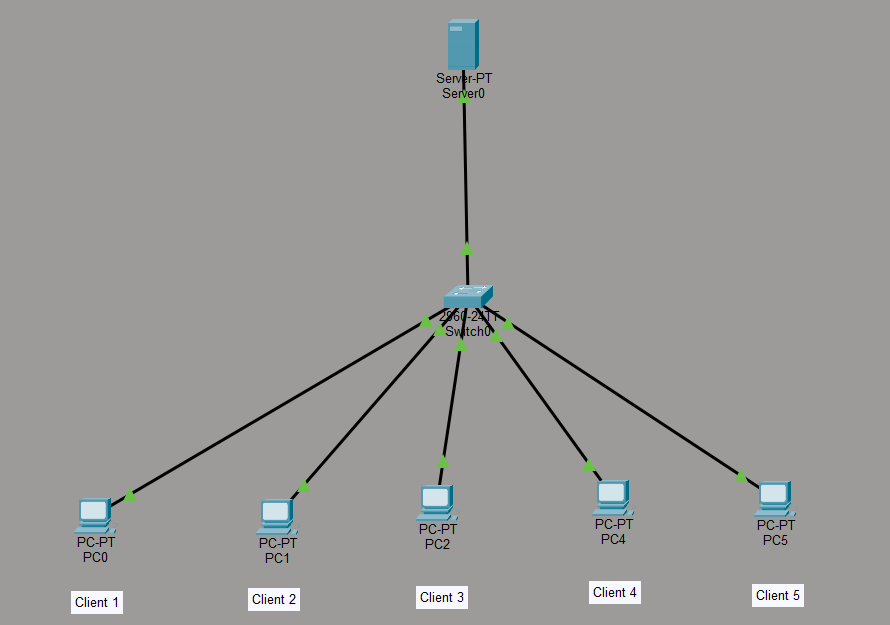

## Plan d'adressage

Réseau `192.168.1.0/24`, adressage statique.

| Équipement | Rôle | Adresse IPv4 | Masque |
|---|---|---|---|
| Server0 | Serveur web du tableau de bord (HTTP) | 192.168.1.1 | 255.255.255.0 |
| PC 1 (Client 1) | Poste de la salle | 192.168.1.2 | 255.255.255.0 |
| PC 2 (Client 2) | Poste de la salle | 192.168.1.3 | 255.255.255.0 |
| PC 3 (Client 3) | Poste de la salle | 192.168.1.4 | 255.255.255.0 |
| PC 4 (Client 4) | Poste de la salle | 192.168.1.5 | 255.255.255.0 |
| PC 5 (Client 5) | Poste de la salle | 192.168.1.6 | 255.255.255.0 |
| Switch0 | Commutateur Cisco 2960-24TT | — | — |

| Serveur | PC 1 |
|---|---|
| 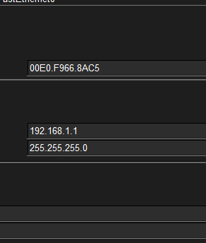 | 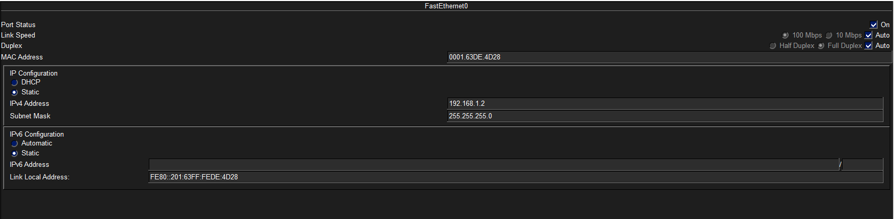 |

## Tests de connectivité TCP/IP

Depuis le PC 1, `ping` vers le serveur et vers chacun des autres postes : **4 paquets envoyés, 4 reçus, 0 % de perte** à chaque fois.

| Vers le serveur | Vers le PC 2 | Vers le PC 5 |
|---|---|---|
| 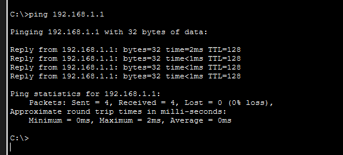 | 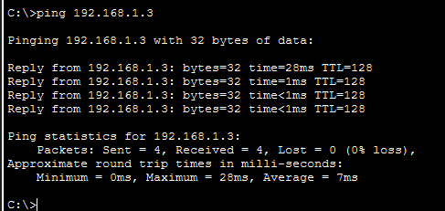 | 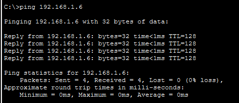 |

## Tableau de bord web

Les pages du tableau de bord sont écrites en **HTML** et hébergées sur le service HTTP du serveur. Chaque poste y accède depuis son navigateur à l'adresse `http://192.168.1.1`.

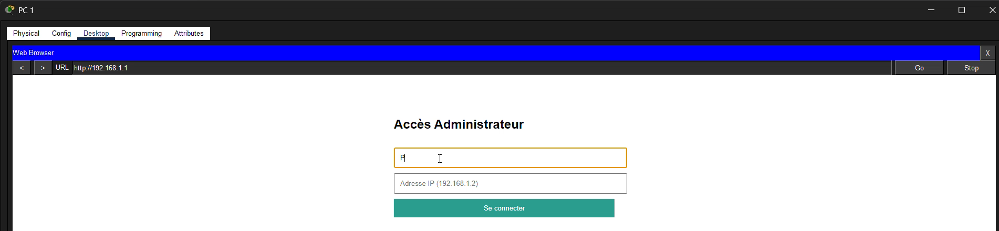

| Page | Rôle |
|---|---|
| Accès administrateur | Identification par nom de poste et adresse IP |
| État des postes | Tableau des 5 PC : adresse IP, état, CPU, RAM, température |
| Envoi de commande | Choix du poste, de la commande (ex. `LOCK`) et d'un message optionnel |
| Confirmation | Récapitulatif : poste, IP, commande exécutée et état |

| Accès administrateur | État des postes |
|---|---|
| 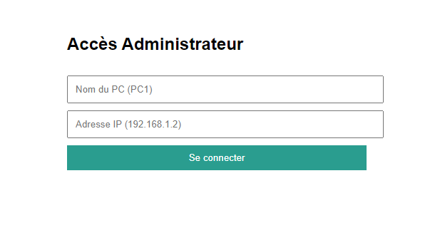 | 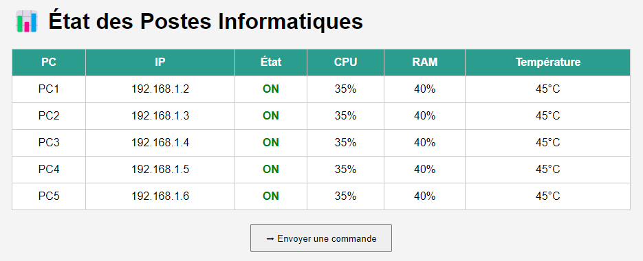 |

| Envoi de commande | Confirmation |
|---|---|
| 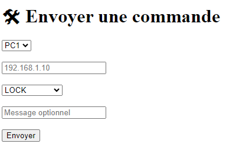 | 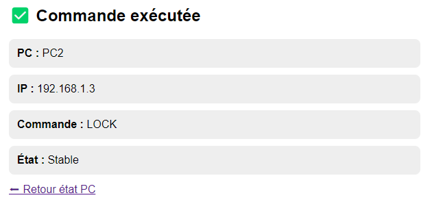 |

## Limites et pistes d'amélioration

Packet Tracer ne permet pas d'exécuter un vrai agent sur les postes : le tableau de bord est une **maquette HTML** et les valeurs affichées (CPU, RAM, température) sont simulées. Pistes pour aller plus loin :

- isoler les postes et le serveur d'administration dans des **VLAN** séparés ;
- remonter de vraies données avec **SNMP** et un outil de supervision ;
- sécuriser l'accès au tableau de bord (HTTPS, authentification réelle) ;
- automatiser les commandes avec un script (par exemple en Python).

## Équipe

- **Awaleh Ismael Awaleh**
- **Bien De Grace KABITOU ONDONGO** — [GitHub](https://github.com/zouloupapers)

Projet encadré par Mme **Sami Hafsi**, Université Centrale (Tunis).
